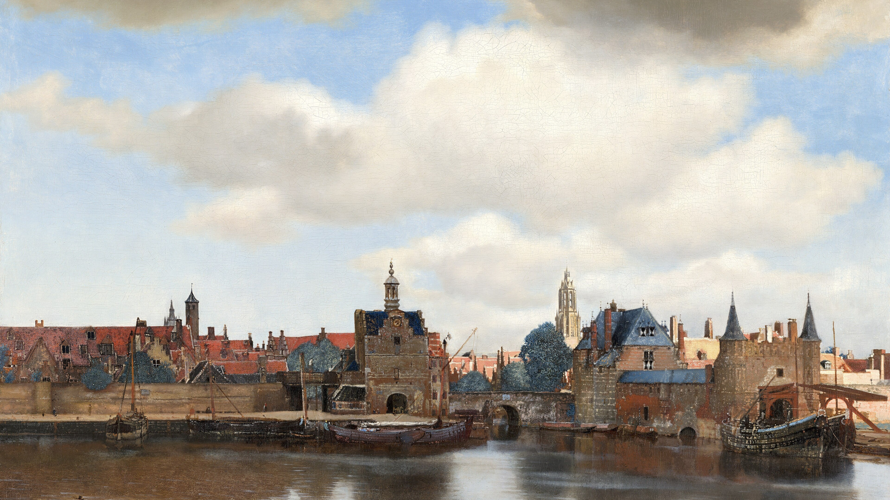

# Vermeer — an Omarchy theme

A calm, candlelit dark theme — umber shadows, natural ultramarine, lead-tin yellow and pearl — from Johannes Vermeer's Delft.



## Install

```bash
omarchy theme install https://github.com/Van-Ausburn/omarchy-vermeer-theme
omarchy theme set vermeer
```

Cycle through the paintings with `omarchy theme bg next`.

## Palette

Umber-shadow background, pearl text, ultramarine accent from the turban in *Girl with a Pearl Earring*, lead-tin yellow from *The Milkmaid*.

| Role | Color |
|---|---|
| `accent` | `#5a85d6` |
| `selection` | `#2c3a5c` |
| `muted` | `#5a554a` |
| `background` | `#1b1a16` |
| `dark_background` | `#13120f` |
| `darker_background` | `#0c0b09` |
| `lighter_background` | `#2a2822` |
| `foreground` | `#ece3cf` |
| `dark_foreground` | `#8c8576` |
| `light_foreground` | `#d8cfba` |
| `bright_foreground` | `#f8f2e4` |
| `red` | `#c25c44` |
| `yellow` | `#e3c45a` |
| `orange` | `#c98a45` |
| `green` | `#7d9468` |
| `cyan` | `#7aa7b0` |
| `blue` | `#5a85d6` |
| `magenta` | `#a07894` |
| `brown` | `#8a6340` |
| `bright_red` | `#d87a63` |
| `bright_yellow` | `#f0d987` |
| `bright_green` | `#9bb286` |
| `bright_cyan` | `#9cc4cc` |
| `bright_blue` | `#85a6e6` |
| `bright_magenta` | `#bf98b3` |

## Boot & login screen

The theme ships an `unlock.png` logo in its accent color. To use it for the Plymouth boot screen and SDDM login:

```bash
omarchy plymouth set by theme vermeer
```


## Wallpapers

All paintings are in the **public domain** and were sourced from Wikimedia Commons:

- [View of Delft](https://commons.wikimedia.org/wiki/File:Johannes_Vermeer_-_View_of_Delft_-_92_-_Mauritshuis.jpg) — Johannes Vermeer, c. 1660–61
- [Girl with a Pearl Earring](https://commons.wikimedia.org/wiki/File:Meisje_met_de_parel.jpg) — Johannes Vermeer, c. 1665
- [The Milkmaid](https://commons.wikimedia.org/wiki/File:Johannes_Vermeer_-_Het_melkmeisje_-_Google_Art_Project.jpg) — Johannes Vermeer, c. 1658
- [The Little Street](https://commons.wikimedia.org/wiki/File:Johannes_Vermeer_-_Gezicht_op_huizen_in_Delft,_bekend_als_'Het_straatje'_-_Google_Art_Project.jpg) — Johannes Vermeer, c. 1658

## License

Theme files (palette, icon choice, previews) are MIT licensed — see [LICENSE](LICENSE).
The paintings are public domain.

The boot-screen logo (`unlock.png`) is a recolored copy of the [Omarchy](https://github.com/basecamp/omarchy) wordmark, Copyright (c) David Heinemeier Hansson, used under the MIT License — see [LICENSE-omarchy](LICENSE-omarchy).
